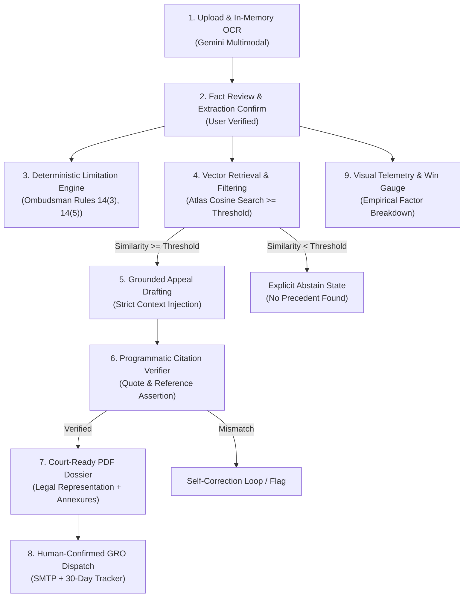

# ARCHITECTURE.md: End-to-End System Blueprint

This document details the architectural design, algorithmic pipelines, data schemas, and safety guardrails powering **Overturn**.

---

## 1. End-to-End Processing Pipeline



### 1. Upload & In-Memory OCR
The user uploads a PDF or photograph. The Express server buffers the file strictly in RAM (`multer.memoryStorage()`) and streams it to the multimodal vision model (`gemini-3.5-flash`) with a strict JSON response schema. No raw image data is ever written to disk.

### 2. User-Editable Fact Extraction
The client renders the extracted facts (Insurer, Policy Number, Claim ID, Stated Denial Reason, Denial Date, Amount) in an interactive review card. The user must verify or adjust these extracted values before any downstream analysis runs.

### 3. Deterministic Limitation & Escalation Engine
A deterministic pure-code module computes statutory dates:
* Verifies Rule 14(3) compliance (must be within 365 days of rejection).
* Verifies Rule 14(5) maintainability (asserts no concurrent court proceedings).
* Verifies Rule 17 financial cap (checks if claim exceeds ₹30,00,000).

### 4. Vector Retrieval with Similarity Threshold
The verified repudiation grounds are converted into a 768-dimensional normalized embedding using `gemini-embedding-001`. MongoDB Atlas executes a `$vectorSearch` with pre-filtering by subject (`grounds: "insurance"`). If the top cosine score is below `SIMILARITY_THRESHOLD` (e.g., 0.72), retrieval halts and emits an explicit abstention state.

### 5. Grounded Appeal Drafting
If retrieval passes the threshold, the LLM receives a context window containing **only** the user facts, the cited statutory rules, and the retrieved judgment text chunks. The system prompt strictly prohibits incorporating outside legal knowledge or ungrounded case citations.

### 6. Programmatic Citation Verifier
Before the generated draft is presented, a deterministic validation function parses the markdown for case numbers, court names, and direct quotes. It asserts that every string matches the retrieved database chunks. If any hallucinated case is detected, the draft is rejected and re-prompted.

### 7. Court-Ready PDF Dossier
The client compiles the verified draft into a standardized legal dossier using `pdf-lib`. The document includes formal caption headers, ground summaries, precedent citations, statutory excerpts, and an evidence annexure checklist.

### 8. Email Dispatch & Reminder Guardian
A user must review the final document and click an explicit "Confirm & Dispatch" button. Node.js dispatches the representation via SMTP to the verified Grievance Redressal Officer (or team sandbox in demo mode), issues a tracking token, and initializes a 30-day statutory countdown timer.

### 9. Visual Telemetry & Win Gauge
An empirical radial gauge visually explains the strength of the user's case based on weighted factors: statutory moratorium violation (+40%), precedent alignment (+35%), and timely intimation (+12%).

---

## 2. Core Data Models (Mongoose Schemas)

### PrecedentChunk Schema (`precedents`)
```javascript
const PrecedentChunkSchema = new mongoose.Schema({
  dataset: { type: String, enum: ['supreme_court', 'high_court'], required: true },
  court: { type: String, required: true }, // e.g., "Supreme Court of India", "Bombay High Court"
  case_id: { type: String, required: true }, // e.g., "Civil Appeal No. 4092 of 2022"
  case_name: { type: String, required: true }, // e.g., "Manmohan Nanda v. United India Assurance"
  judgment_date: { type: Date, required: true },
  year: { type: Number, required: true },
  source_s3_key: { type: String, required: true },
  chunk_text: { type: String, required: true },
  grounds: [{ type: String }], // e.g., ["pre_existing_disease", "repudiation", "moratorium"]
  embedding: { type: [Number], required: true } // 768-dim normalized vector
});
```

### Case Schema (`cases`)
```javascript
const CaseSchema = new mongoose.Schema({
  extracted_facts: {
    insurer_name: { type: String, required: true },
    policy_number: String,
    claim_id: String,
    denial_amount: Number,
    rejection_date: Date,
    raw_stated_grounds: String,
    statutory_clause: String
  },
  deadlines: {
    statutory_limitation_date: Date, // Exactly 1 year from rejection_date
    insurer_gro_deadline_30d: Date,   // 30 days from dispatch
    is_time_barred: { type: Boolean, default: false }
  },
  retrieval_meta: {
    matched_precedents: [{ type: mongoose.Schema.Types.ObjectId, ref: 'PrecedentChunk' }],
    max_similarity_score: Number,
    abstained: { type: Boolean, default: false }
  },
  verified_draft_markdown: String,
  dispatch_log: {
    dispatched_to: String,
    dispatched_at: Date,
    tracking_token: String,
    human_confirmed: { type: Boolean, default: false }
  }
}, { timestamps: true });
```

### RuleSet Schema (`rulesets`)
```javascript
const RuleSetSchema = new mongoose.Schema({
  statute_name: { type: String, required: true }, // "Insurance Ombudsman Rules 2017"
  rule_number: { type: String, required: true },  // "14(3)", "17(1)"
  title: { type: String, required: true },
  rule_type: { type: String, enum: ['LIMITATION', 'BAR', 'CAP', 'GROUND'], required: true },
  statutory_text: { type: String, required: true },
  numeric_limit: Number // e.g., 3000000 for ₹30L cap
});
```

---

## 3. MongoDB Atlas Vector Search Index

The Atlas Vector Search index on the `precedents` collection is defined as follows:

```json
{
  "fields": [
    {
      "type": "vector",
      "path": "embedding",
      "numDimensions": 768,
      "similarity": "cosine"
    },
    {
      "type": "filter",
      "path": "court"
    },
    {
      "type": "filter",
      "path": "year"
    },
    {
      "type": "filter",
      "path": "grounds"
    }
  ]
}
```

---

## 4. Guardrails & Safety Architecture

1. **Similarity Threshold Abstention:** If `max(similarity_score) < SIMILARITY_THRESHOLD`, the pipeline aborts drafting and notifies the user that no direct legal precedent could be retrieved.
2. **Deterministic Citation Verifier:** An independent software layer performs string-containment and regex checks against the retrieved chunk. Any citation not present verbatim in the chunk raises a `CitationVerificationError`.
3. **Model Fallback Chain:** If the primary generation model times out after 15 seconds, the request retries against `GEMINI_FALLBACK_MODEL_ID`. If embeddings fail, fallback routes to `GEMINI_FALLBACK_EMBEDDING_MODEL_ID`.

---

## 5. Edge Cases & Resilience Matrix

| Edge Case | Detection Mechanism | System Response & UI Behavior |
| :--- | :--- | :--- |
| **Blurry or Unreadable Image** | Gemini extraction returns confidence < 0.6 or empty fields | Renders upload error: *"Document unreadable. Please upload a clear photo or PDF."* |
| **Non-Insurance Document** | Classification guardrail flags absence of insurance identifiers | Blocks analysis: *"Uploaded file does not appear to be an insurance repudiation letter."* |
| **Missing Rejection Date** | Date field is `null` after extraction | Prompts user with interactive date-picker: *"Please specify the date on the letter to compute deadlines."* |
| **Regional Language Letter** | Language tag != `en` in extraction payload | Multimodal model translates letter context to English for vector matching while preserving native quotes. |
| **Gemini API Timeout (>15s)** | Express request timer triggers abort | Automatically retries against fallback model; notifies user of extended latency. |
| **No Precedents Retrieved** | Atlas Vector query returns 0 chunks above threshold | Abstains from drafting; provides statutory rule analysis without case citations. |

---

## 6. Privacy Architecture & Technical Roadmap

* **In-Memory & TTL Retention:** Uploaded files exist solely in process memory during OCR. Stored case records feature MongoDB TTL indexes, auto-purging user submissions after 30 days unless explicitly saved.
* **Roadmap Expansion:**
  * Ingest and index State and National Consumer Commission (NCDRC/SCDRC) full-text orders.
  * Web-crawl and structure Insurance Ombudsman awards directly from regional gazette publications.
  * Direct browser-agent assistance for uploading Form VI dossiers to the e-Daakhil consumer litigation portal.
